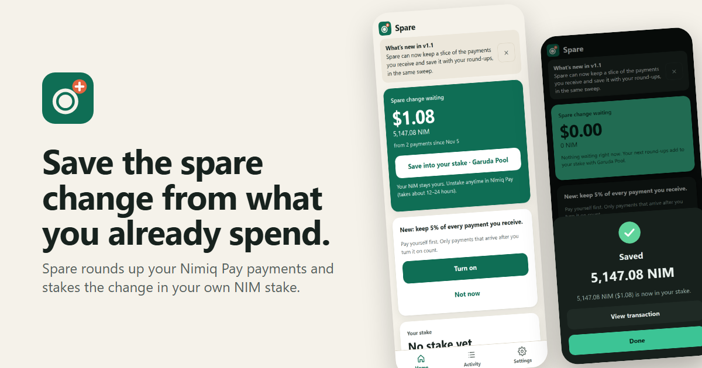
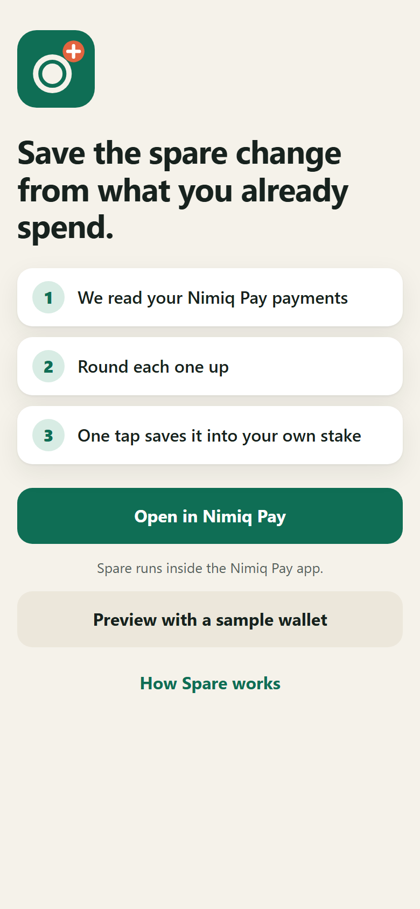
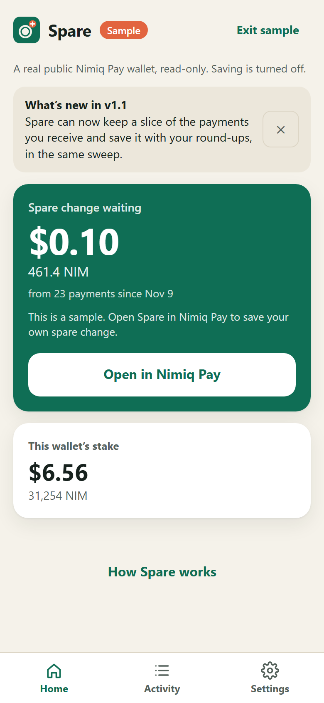
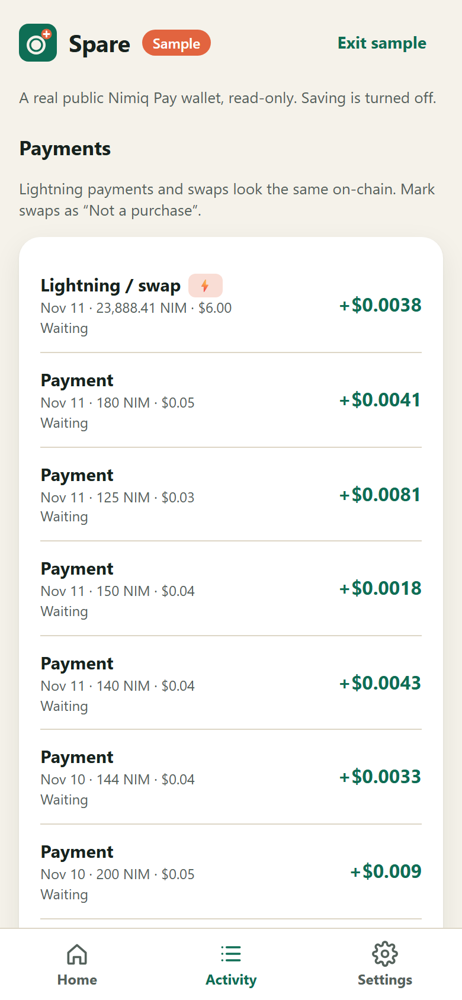
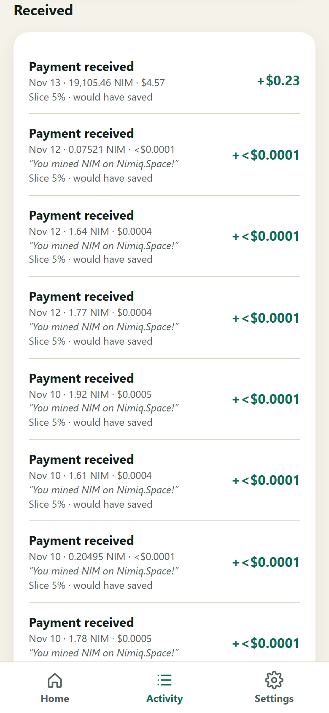
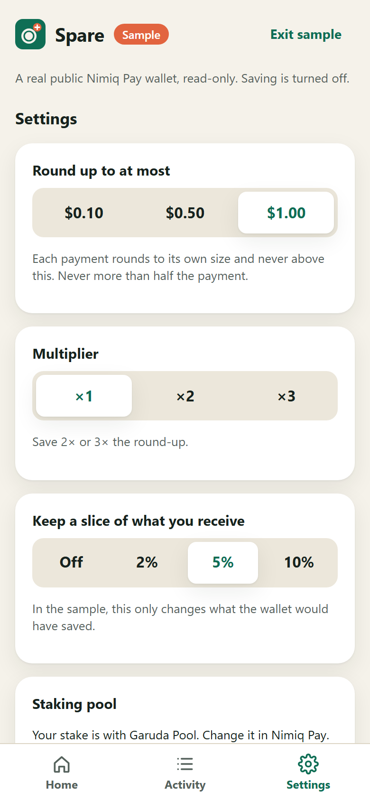
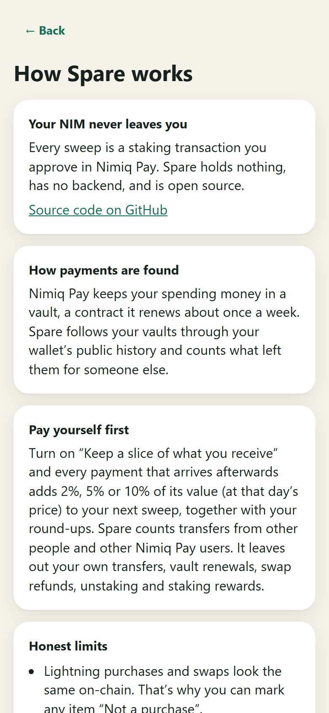
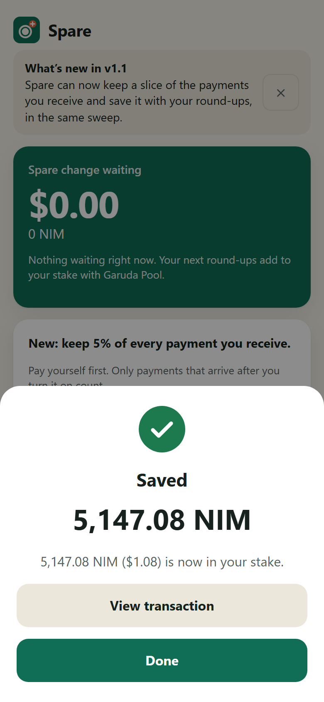

# Spare

**Spare rounds up the payments you already make with Nimiq Pay and saves the spare change into your own NIM stake.**

**Live:** https://spare-dun.vercel.app. Open it inside Nimiq Pay with https://nimpay.app/miniapps/open/spare-dun.vercel.app.



Built for the Nimiq Mini Apps Competition, Cycle III (Save track).

## Why

Most savings apps ask you to remember to save, and most people stop after a few weeks. Round-ups work the other way round: you keep paying as you always do, and the small difference to the next round amount is set aside. Spare brings that habit to Nimiq Pay. There's nothing new to remember, and one tap a week puts the change to work in your own stake.

## How it works

1. **Spare reads your payments.** Nimiq Pay keeps your spending money in a *vault*, a contract co-signed by Nimiq Pay that it renews about once a week. Spare follows your vaults through your wallet's public history and counts what left them for someone else. It leaves out your own transfers, staking and refunds.
2. **Each payment is rounded up.** Each payment is valued in your Nimiq Pay currency at that day's price and rounded to a step that fits its size: `step = min(your max step, 10^floor(log10(amount)))`. The round-up is `ceil(amount/step) × step − amount`, never more than **50% of the payment**, and then optionally ×2 or ×3. A $2.89 coffee rounds to $3.00 and saves $0.11. A $0.26 payment rounds to $0.30.
3. **One tap saves it into your own stake.** The total is converted to NIM at today's price and staked with one transaction you approve in Nimiq Pay. If you don't stake yet, that's a new stake with a pool you choose (100 NIM network minimum). If you already stake, it's added to your existing stake. You can unstake anytime in Nimiq Pay; it takes about 12–24 hours (one to two staking epochs).

You can mark anything as **"Not a purchase"**, and it won't be rounded up.

### New in v1.1: pay yourself first

Turn on **"Keep a slice of what you receive"** (Off / 2% / 5% / 10%; off by default) and every payment that arrives **after** you turn it on adds that share of its value, at that day's price, to your next sweep. Round-ups and slices go into your stake in **one** transaction, and History shows the split: *Round-ups: X · Slices: Y (· Starter top-up: Z)*.

What counts as received (verified on real wallets, see `scripts/trace-income.ts` and `tests/fixtures/income-*.json`):

- **Counted:** transfers from other people and apps, and payments from other Nimiq Pay users. Those arrive from *their* vault, a contract Spare reads once to confirm it is a vault (all-zero hash lock) owned by someone else. On testnet, the faucet counts too.
- **Left out:** your own transfers and vault renewals, swap refunds and claims, the swap service, and unstaking. **Staking pool payouts** are labelled *reward* and left out by default, since they're already in "Earned on top". You can count one yourself.
- Each payment received can be marked **"Not counted"**. The sample wallet shows what it *would have saved* at 5% over 30 days.

## Non-custodial, no backend

- Every sweep is a staking transaction **you approve** in Nimiq Pay. Spare never holds funds or keys.
- There is **no backend**. Spare is a static web app that reads public data: the Nimiq chain (public RPC), prices (DefiLlama), exchange rates (currency-api) and staking pools (validators API).
- Settings, "Not a purchase" marks and your sweep history stay on your device. Your stake itself is read from the chain, so it's right on any device.
- Open source under MIT.

## Proof

Real Spare sweeps made inside Nimiq Pay on testnet:

| | Amount | Transaction |
| --- | --- | --- |
| New stake (Siam Testnet Pool) | 266.55895 NIM | [68ae412a…ae22](https://test.nimiq.watch/#68ae412aac302de10468fb6bbbfd489de7261b8c02a7653cb879f8d8fb44ae22) |
| Add to stake | 747.25669 NIM | [24eadf8d…5461](https://test.nimiq.watch/#24eadf8d4b271d94ab02d44480d796f766cf7e6e5bf7dfa7c0faf09dc9ac5461) |

Both were sent from the wallet's vault to the staking contract. The wallet's staker balance afterwards was exactly 1,013.81564 NIM, the sum of the two. A mainnet slot is ready in `src/ui/HowItWorks.tsx` (`PROOF_TXS`).

## Honest limits

- **Lightning payments and swaps look the same on-chain.** Both leave the vault into a swap contract, so Spare labels them "Lightning / swap" and you can mark swaps "Not a purchase".
- **Prices can lag a day.** NIM/USD comes from DefiLlama and other currencies from a daily exchange-rate snapshot. A missing day uses the nearest day and is marked.
- **Staking rewards vary by pool** and aren't guaranteed. **Unstaking takes about 12–24 hours.**
- **First stake needs 100 NIM** (network rule). Until then your spare change waits, or "Start my stake now" adds the difference, shown as a separate *starter top-up* and never counted as savings.
- **A received payment can't be told apart from a friend returning your own money.** Mark it "Not counted" if so.
- **Pool payouts** are recognised when they come from the validator's own address (the only payout path seen on chain; restake pools pay through the staking contract). A pool that paid from another address would count as received until you mark it.
- The public RPC allows 20 requests per ~10 s per IP. Spare caches history and stays under that limit; a first load of a busy wallet takes a few seconds.

## Screens

| Welcome | Home | Activity | Received (v1.1) | Settings | How it works | Saved |
| --- | --- | --- | --- | --- | --- | --- |
|  |  |  |  |  |  |  |

Dark mode versions are in [`screenshots/`](screenshots). The app is in English and Spanish and follows Nimiq Pay's language and currency (USD, EUR, CRC, GMD). Outside Nimiq Pay, "Preview with a sample wallet" shows a real, public, read-only Nimiq Pay wallet labelled "Sample", with saving turned off.

---

## For developers

### Run locally

```bash
npm install
npm run dev     # prints http://<LAN IP>:5173; open it in Nimiq Pay > Mini Apps (same Wi-Fi)
npm test        # vitest, unit tests on real mainnet fixtures
npm run build   # tsc -b (strict) + vite build
```

**Testnet:** in Nimiq Pay, long-press Settings for 10 s to open the dev menu and switch to Testnet, then use "Get free NIM" (110,000 NIM). Spare follows the host network: testnet RPC, testnet pools, and `test.nimiq.watch` links.

Scripts:

```bash
npx tsx scripts/trace.ts "<NQ wallet>" 30         # vaults found + every outgoing tx with its kind
npx tsx scripts/quote.ts "<NQ wallet>" CRC        # round-ups and getSweepQuote()
npx tsx scripts/trace-income.ts "<NQ wallet>" 30 mainnet [fixture]  # incoming txs: received vs left out, and why
npx tsx scripts/find-sample.ts                     # pick the public sample wallet from recent mainnet activity
npm run build && npx tsx scripts/screenshots.ts    # 390×844 light/dark screenshots + thumbnail (Playwright)
npx tsx scripts/capture-fixtures.ts                # re-capture raw RPC fixtures
npx tsx scripts/capture-staking-fixtures.ts
```

### How spending is detected

A vault is an HTLC whose creation data (`recipientData`) has these values:

- sender (the refund address) = the wallet
- hashRoot = 32 zero bytes (blake2b, hashCount 1)

Its recipient is the Nimiq Pay cosigner. Swap HTLCs also have sender = wallet, but they carry a real sha256 lock. Expired HTLCs are pruned from account state, so ownership is always read from the creation tx. Every tx sent from the wallet or one of its vaults is classified:

| kind | rule |
| --- | --- |
| failed | `executionResult === false` |
| staking | to the staking contract `NQ77 0000 … 0001` |
| internal | to the wallet, a vault, a new vault, or a swap HTLC that refunded |
| lightning | into any other HTLC |
| fee-only | value 0 |
| payment | anything else |

Only `payment` and `lightning` count. The cache (`src/chain/cache.ts`, localStorage with an in-memory fallback, keyed `${network}:${wallet}`) refreshes incrementally up to the newest known tx and never refetches finished vaults.

### Sweep

- **Staker identity:** Nimiq Pay stakes *from the vault*, but the **staker is the wallet** (`getStakerByAddress(wallet)`).
- **Minimum stake:** `minimumStake` = 100 NIM. Under core-rs `enforce_min_stake`, active+inactive must be 0 or ≥ 100 NIM after any change.
- **Persistence:** each sweep is saved before the wallet dialog opens and confirmed with `getTransactionByHash`. Items are marked saved only on confirmation.
- **Unknown outcome:** a `TRANSACTION_OUTCOME_UNKNOWN` blocks retries until the chain answers, so nothing is ever double-swept.

### Credits

- [`@nimiq/mini-app-sdk`](https://www.npmjs.com/package/@nimiq/mini-app-sdk) (MIT) and the official Nimiq `mini-apps` AI skill (`npx skills add nimiq/developer-center --skill mini-apps`).
- [Nimiq validators API](https://validators-api-main.je-cf9.workers.dev/api/v1/validators) for pool ranking, fees and payout schedules.
- [DefiLlama](https://defillama.com/docs/api) coins API (`coingecko:nimiq-2`) for NIM prices, with [CoinGecko](https://www.coingecko.com/en/api) as the fallback.
- [fawazahmed0/currency-api](https://github.com/fawazahmed0/exchange-api) for daily USD→EUR/CRC/GMD rates.
- [nimiq.watch](https://nimiq.watch) public RPC and explorer.
- [Kuza](https://github.com/swiftbotlabs/kuza) (MIT, © 2026 Swift Bot Labs): `classifyWalletError` adapts Kuza's wallet error classification (`PERMISSION_DENIED`/4001 = cancelled, `TRANSACTION_OUTCOME_UNKNOWN`/-32001 = unknown, hash from `error.data.hash`). Its notes also pointed to the core-rs minimum-stake rules, which Spare re-checked in core-rs.
- [accrue](https://github.com/RaYYeR220/accrue) (MIT, © 2026 RaYYeR220): `spendableLuna` follows accrue's rule that one staking tx is funded from the vault when it holds NIM, otherwise from the wallet.
- [NimBooks](https://github.com/subimpact/nimbooks) (MIT): reading its price code is how we learned that `nimiq-2` is the live CoinGecko id. No code was copied.

## License

MIT © Soham Juneja
